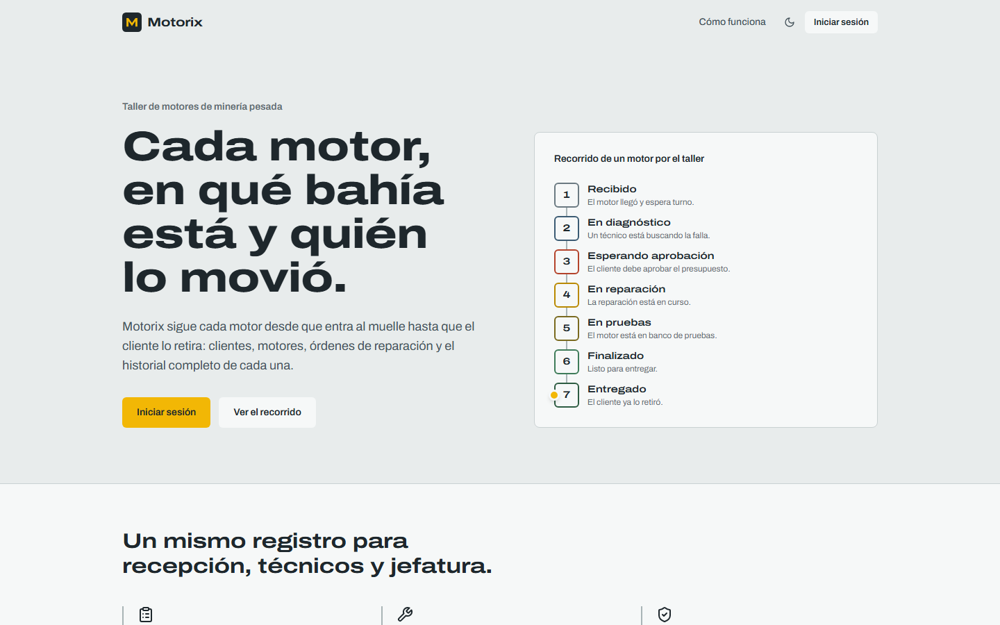

<h1 align="center">
  Motorix
</h1>

<p align="center">
  
  
  
  
  
  
  
  
  
  
  
  
  
  
  
  
  
  
  
</p>

<p align="center">
  
</p>

<p align="center">
  <strong>Español</strong> | <a href="./README.md">English</a>
</p>

Motorix es una plataforma interna para un taller de reparación de motores de minería pesada. Permite hacer seguimiento de clientes, motores y órdenes de reparación en cada etapa del proceso, construida como una arquitectura de microservicios con dos API independientes, un frontend web y control de acceso por roles protegido con JWT firmados con RS256.

## Stack tecnológico

| Componente | Stack | Responsabilidad |
| --- | --- | --- |
| `apps/web` | React, TypeScript, Vite, Tailwind CSS, React Router, Axios, Bun | Interfaz de usuario |
| `services/auth-api` | Express, TypeScript, Prisma, Argon2, Bun | Usuarios, roles (`root`, `admin`, `user`), inicio de sesión y emisión de JWT (RS256) |
| `services/business-api` | FastAPI, Python, SQLAlchemy, Alembic, Uvicorn | Clientes, motores, órdenes de reparación e historial de estados |
| `postgres` | PostgreSQL 17 | Una instancia, una base de datos aislada por servicio |
| Entrega | Docker Compose, Nginx, GitHub Actions, MkDocs Material | Stack local, proxy inverso, CI y documentación |

La API de autenticación firma los tokens con una clave privada RSA. La API de negocio solo tiene la clave pública y verifica firma, expiración, emisor y audiencia en cada petición protegida. Ningún servicio puede leer la base de datos del otro.

Consulta la [documentación técnica](docs/README.md) para más detalles.

## Estructura del repositorio

```
motorix/
├── apps/
│   └── web/                   # React + TypeScript
├── services/
│   ├── auth-api/              # Express + TypeScript
│   └── business-api/          # FastAPI + Python
├── infrastructure/
│   ├── docker/
│   ├── nginx/
│   └── scripts/               # Init de Postgres y generación de claves
├── docs/
│   ├── en/                    # Documentación en inglés
│   └── es/                    # Documentación en español
├── .github/workflows/         # Un workflow de CI por componente
├── compose.yaml
├── mkdocs.yml
└── .env.example
```

## Requisitos

- Docker Engine con el plugin de Compose
- OpenSSL (para generar el par de claves JWT)
- Python 3.12+ y Bun 1.1+ para desarrollo local sin contenedores

## Puesta en marcha

La [guía de primeros pasos](docs/es/getting-started.md) explica cómo instalar Bun y Docker (incluido Windows sin Docker Desktop) y describe cada variable de entorno. Inicio rápido:

1. Copia las plantillas de entorno y define valores reales:

   ```bash
   cp .env.example .env
   ```

   Cada componente tiene además su propio `.env.example` dentro de su carpeta.

2. Genera el par de claves RS256 para firmar y verificar los JWT:

   ```bash
   sh infrastructure/scripts/generate-jwt-keys.sh
   ```

   En Windows PowerShell, usa `infrastructure\scripts\generate-jwt-keys.ps1` en su lugar. Las claves se escriben en `secrets/jwt/`, que Git ignora.

3. Levanta el stack:

   ```bash
   docker compose up -d
   ```

## Documentación

La documentación se construye con MkDocs Material en inglés y español, y se publica en <https://zerik-official.github.io/Motorix/docs/>. Para servirla en local:

```bash
pip install -r requirements-docs.txt
mkdocs serve
```