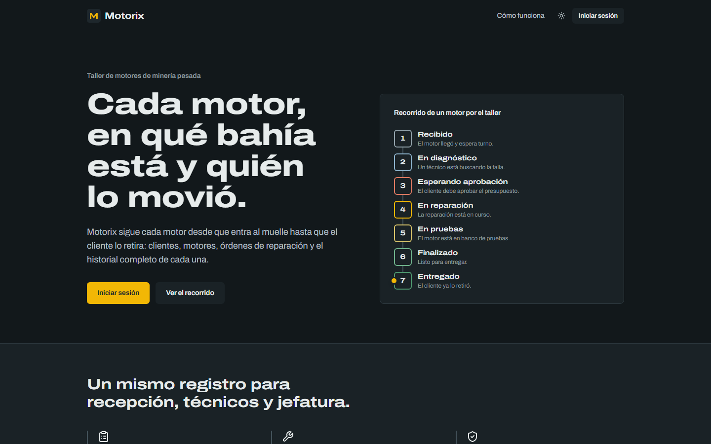

<h1 align="center">
  Motorix
</h1>

<p align="center">
  
  
  
  
  
  
  
  
  
  
  
</p>

<p align="center">
  
</p>

<p align="center">
  <a href="./README.es.md">Español</a> | <strong>English</strong>
</p>

Motorix is an internal platform for a heavy mining engine repair shop. It tracks clients, engines and repair orders through every stage of the repair process, built as a microservices architecture with two independent APIs, a web frontend and role-based access secured with RS256-signed JWTs.

## Tech stack

| Component | Stack | Responsibility |
| --- | --- | --- |
| `apps/web` | React, TypeScript, Vite, Tailwind CSS, React Router, Axios, Bun | User interface |
| `services/auth-api` | Express 5, TypeScript, Prisma, zod, jose, Bun (runtime and Argon2id), Cloudflare Turnstile | Users, roles (`root`, `admin`, `user`), permissions, login and JWT issuance (RS256) |
| `services/business-api` | FastAPI, Python, SQLAlchemy, Alembic, Uvicorn | Clients, engines, repair orders and status history |
| `postgres` | PostgreSQL 17 | One instance, one isolated database per service |
| Delivery | Docker Compose, Nginx, GitHub Actions, MkDocs Material | Local stack, reverse proxy, CI and documentation |

The auth API signs tokens with an RSA private key. The business API only holds the public key and verifies signature, expiration, issuer and audience on every protected request. Neither service can read the other's database.

See the [technical documentation](docs/README.md) for details.

## Repository structure

```
motorix/
├── apps/
│   └── web/                   # React + TypeScript
├── services/
│   ├── auth-api/              # Express + TypeScript
│   └── business-api/          # FastAPI + Python
├── infrastructure/
│   ├── docker/
│   ├── nginx/
│   └── scripts/               # Postgres init and key generation
├── docs/
│   ├── en/                    # English documentation
│   └── es/                    # Spanish documentation
├── .github/workflows/         # One CI workflow per component
├── compose.yaml
├── mkdocs.yml
└── .env.example
```

## Requirements

- Docker Engine with the Compose plugin, or a native PostgreSQL install (see [Without Docker](docs/en/getting-started.md#without-docker))
- OpenSSL (to generate the JWT key pair)
- Python 3.12+ and Bun 1.1+ for local development without containers

## Getting started

The [getting started guide](docs/en/getting-started.md) covers installing Bun and Docker (including Windows without Docker Desktop) and describes every environment variable. Quick start:

1. Copy the environment templates and set real values:

   ```bash
   cp .env.example .env
   ```

   Each component also has its own `.env.example` inside its folder.

2. Generate the RS256 key pair used to sign and verify JWTs:

   ```bash
   sh infrastructure/scripts/generate-jwt-keys.sh
   ```

   On Windows PowerShell, use `infrastructure\scripts\generate-jwt-keys.ps1` instead. Keys are written to `secrets/jwt/`, which is ignored by Git.

3. Start the stack:

   ```bash
   docker compose up -d
   ```

   Without Docker, create the databases on a native PostgreSQL as described in [Without Docker](docs/en/getting-started.md#without-docker).

## Documentation

The documentation is built with MkDocs Material in English and Spanish, and published at <https://zerik-official.github.io/Motorix/docs/>. To serve it locally:

```bash
pip install -r requirements-docs.txt
mkdocs serve
```