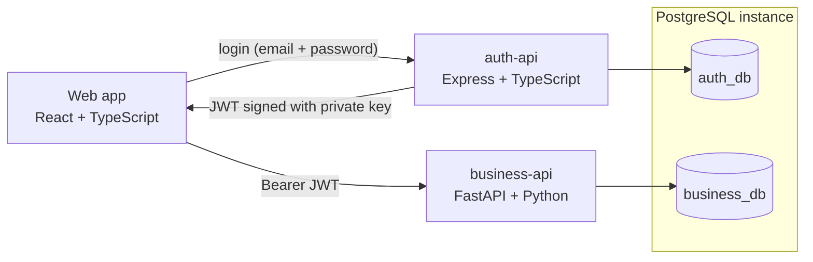

# Architecture

## Components

| Component | Responsibility | Owns |
| --- | --- | --- |
| Web app | Login, dashboard, clients, engines and repair orders views | No data |
| auth-api | User registration and management, roles, login, JWT issuance | `auth_db`, RSA private key |
| business-api | Clients, engines, repair orders and status history | `business_db`, RSA public key |

## Communication

- The web app authenticates **only** against `auth-api` and receives a JWT.
- The web app sends that JWT as a `Bearer` token to `business-api`.
- `business-api` verifies the token locally with the public key. It never calls `auth-api` to validate a request, so both services can run and scale independently.
- Inside one host, services talk over the private Docker network (HTTP). Across hosts, traffic goes through Nginx with TLS (HTTPS).

## Layered design

Both APIs follow the same object-oriented layered structure:

| Layer | business-api (FastAPI) | auth-api (Express) |
| --- | --- | --- |
| Transport | Routers + Pydantic schemas | Routes + controllers + zod schemas |
| Business rules | Services | Services |
| Data access | Repositories (SQLAlchemy) | Repositories (Prisma) |
| Persistence | Alembic migrations | Prisma migrations |

Routers never access the database directly. Services depend on repositories, which keeps business rules testable and the storage replaceable.

Each request of `business-api` is one unit of work: one session, committed when the endpoint succeeds and rolled back when it fails. The commit runs **before** the response is sent (`scope="function"` on the session dependency), so a client that receives a `201` can read the new row in its very next request, and a commit that fails reaches the client as an error instead of a success. A test records the order of the commit and the response to keep it that way.

## Scalability decisions

- **Paginated listings**: every list endpoint is paginated with a capped page size, so a request never loads the whole table.
- **Keyset pagination for repair orders**: the order list uses a cursor over `(created_at, id)`, which keeps the cost of a page constant even with millions of rows, unlike deep `OFFSET` pages.
- **No N+1 queries**: related data (the engine and client of an order, the owner of an engine) is loaded with eager loading in the same round trip instead of one query per row. Tests count the SQL statements of the order and engine listings and check that a bigger page never adds queries.
- **Dashboard summary in one query**: `GET /api/v1/repair-orders/summary` counts the orders of every status with a single `GROUP BY`, instead of the web app paging through every order to count them.
- **Search without extra round trips**: the order search matches the order number and reported issue directly, and the engine serial number and client name through correlated `EXISTS` subqueries, so it stays one statement. It uses `ILIKE '%text%'`, which a B-tree index cannot serve; if the table grows large, a `pg_trgm` GIN index on those columns would make it indexed.
- **Indexes** on every column used for filtering or sorting (status, client, engine, creation date).
- **Database per service** in a single PostgreSQL instance: simple to operate today and ready to move each database to its own server.

## Logging

Each service writes colored console logs and keeps a copy without colors in `logs/<service>/<YYYY-MM>/<YYYY-MM-DD>.log`. Log levels support a numeric verbosity, and specific levels can be suppressed through environment variables to reduce noise.