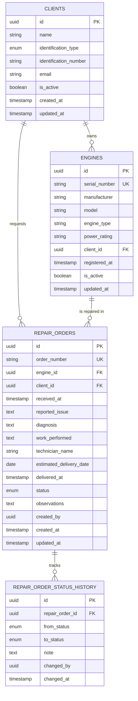

# Data model

Each service owns its own database inside the same PostgreSQL instance. There are no foreign keys across databases: `business-api` stores the user identifier from the JWT (`sub`) as a plain UUID.

## auth_db (auth-api)

```mermaid
erDiagram
    USERS {
        uuid id PK
        string email UK
        string full_name
        string password_hash
        enum role "root | admin | user"
        boolean is_active
        timestamp created_at
        timestamp updated_at
    }
```

## business_db (business-api)

## Constraints and rules

- **Clients**: unique `(identification_type, identification_number)` to prevent duplicates.
- **Engines**: unique `serial_number`.
- **Repair orders**: unique `order_number`. The client is stored on the order as a snapshot of the owner at reception, and must match the engine's owner when the order is created.
- **Status**: `received`, `in_diagnosis`, `awaiting_approval`, `in_repair`, `in_testing`, `finished`, `delivered`. Every change creates a row in `repair_order_status_history`.
- **Technician**: stored as reference text; no user account is required.
- **Soft delete**: clients and engines are deactivated (`is_active = false`) instead of being removed, so the order history is preserved.

## Indexes

| Table | Index | Reason |
| --- | --- | --- |
| `engines` | `client_id` | Engines of a client |
| `repair_orders` | `status` | Dashboard and status filter |
| `repair_orders` | `client_id`, `engine_id` | Filters by client and engine |
| `repair_orders` | `(created_at, id)` | Keyset pagination |
| `repair_order_status_history` | `(repair_order_id, changed_at)` | Order timeline |

## Initialization

- The PostgreSQL container runs `infrastructure/scripts/postgres/01-create-databases.sh` on first start to create both databases and their roles.
- Each service applies its own schema with its migration tool (Alembic for `business-api`, Prisma for `auth-api`).
