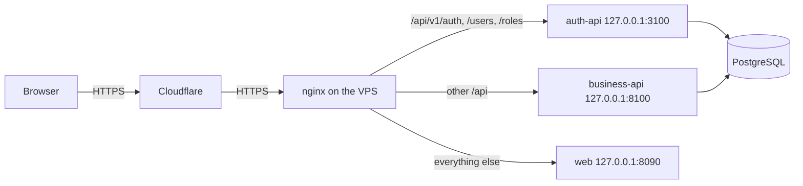

# Deployment

Every merge to `main` deploys Motorix to a single Ubuntu VPS. GitHub Actions builds one image per component, publishes them to the GitHub Container Registry, and tells the server to pull them and restart the stack. Each API applies its own migrations when its container starts, before it serves traffic.

## Topology

- The web app and both APIs share one origin, `https://motorix.zerikapi.site`, so the browser needs no CORS and the refresh cookie keeps its `Path=/api/v1/auth`.
- The containers only publish ports on `127.0.0.1`; PostgreSQL publishes none. The services reach each other and the database through the Docker network.
- nginx takes the client address from `CF-Connecting-IP` only when the request comes from a Cloudflare range, and forwards it as the single `X-Forwarded-For` value, so the rate limits count real clients.

## Files

| File | Role |
| --- | --- |
| `services/*/Dockerfile`, `apps/web/Dockerfile` | Images. The APIs run their migrations (`prisma migrate deploy`, `alembic upgrade head`) and then start; the web image serves the static build with nginx. Each image has a health check. |
| `compose.yaml` | The whole stack, buildable locally with `docker compose up -d --build`. |
| `compose.prod.yaml` | Production override: registry images tagged with the commit, production settings, ports on `127.0.0.1`. |
| `infrastructure/nginx/motorix.zerikapi.site.conf` | Site of the host nginx: TLS, security headers and routing. |
| `infrastructure/nginx/cloudflare-real-ip.conf` | Cloudflare address ranges trusted for the client address. |
| `infrastructure/scripts/bootstrap-server.sh` | One time setup: writes the production `.env` files with random passwords and generates the RS256 key pair. It never overwrites an existing file. |
| `infrastructure/scripts/deploy.sh` | Pulls the images of a commit, starts the stack, waits until every health check passes, and removes older Motorix images. |
| `.github/workflows/deploy.yml` | Runs on every push to `main`, or by hand. |

## GitHub configuration

Create the `production` environment in **Settings → Environments**, and add:

| Kind | Name | Value |
| --- | --- | --- |
| Secret | `VPS_HOST` | Address of the server. |
| Secret | `VPS_USER` | User that runs the deploy; it must belong to the `docker` group. |
| Secret | `VPS_SSH_KEY` | Private key of a key pair used only for deploys. |
| Secret | `VPS_KNOWN_HOSTS` | Output of `ssh-keyscan -t ed25519 <host>`, so the runner verifies the server. |
| Variable | `PUBLIC_URL` | `https://motorix.zerikapi.site` |
| Variable | `TURNSTILE_SITE_KEY` | Public Turnstile site key of the domain. |

The deploy logs the server in to the registry with the short lived token of the run and logs it out at the end, so no registry credential stays on the server.

## Server setup

Done once, with the deploy user:

1. Clone the repository in `~/motorix` and run `sh infrastructure/scripts/bootstrap-server.sh https://motorix.zerikapi.site <root email>`.
2. Set `TURNSTILE_SECRET_KEY` in `services/auth-api/.env`; `auth-api` refuses to start in production without it.
3. Read the first password of `root` in `services/auth-api/.env`, sign in, change it from the app, and remove `ROOT_PASSWORD` from the file.
4. With `sudo`: copy `cloudflare-real-ip.conf` to `/etc/nginx/snippets/`, get the certificate with `certbot certonly --nginx -d motorix.zerikapi.site`, copy the site to `/etc/nginx/sites-available/`, enable it, and run `nginx -t && systemctl reload nginx`.

## Cloudflare

| Setting | Value |
| --- | --- |
| DNS record | `A`, name `motorix`, content the address of the server, TTL auto |
| Proxy status | DNS only while certbot issues the first certificate, then proxied |
| SSL/TLS mode | Full (strict) |
| Turnstile widget | Hostname `motorix.zerikapi.site` |
