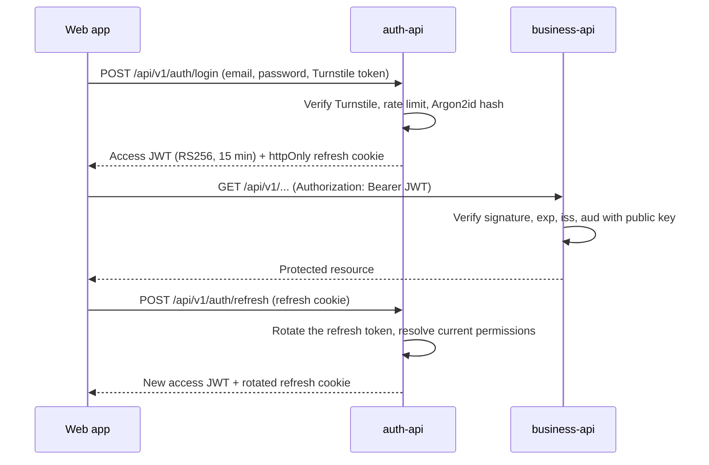

# Security

## Authentication flow

## JWT with RS256

- `auth-api` signs tokens with an **RSA private key**. It is the only component that can issue tokens.
- `business-api` holds only the **public key**. It can verify tokens but never create them, so the authentication responsibility is not duplicated.
- No user credentials are shared between services.

Claims included in every token:

| Claim | Purpose |
| --- | --- |
| `sub` | User identifier |
| `role` | Authorization role (`root`, `admin` or `user`) |
| `permissions` | Permissions the role held at login (see [Permissions](#permissions)) |
| `iss` | Issuer, must match the value expected by `business-api` |
| `aud` | Audience, must match the value expected by `business-api` |
| `iat` / `exp` | Issue and expiration time |

`business-api` rejects a token when the signature is invalid, the token is expired, or `iss`/`aud` do not match. Decoding the payload alone is never enough.

## Key management per environment

| Environment | How keys are provided |
| --- | --- |
| Local | Generated with `infrastructure/scripts/generate-jwt-keys.sh` into `secrets/jwt/` (ignored by Git) and mounted read-only into the containers |
| CI | A fresh key pair is generated on every run; no secret is stored |
| Staging / production | Private key stored as a GitHub Actions secret and written to the server with `600` permissions; only `auth-api` receives it |

Rotation: generate a new pair, deploy the public key to `business-api`, then the private key to `auth-api`. Tokens signed with the old key expire on their own.

## Sessions

The access token is short lived (`JWT_EXPIRES_IN_SECONDS`, 15 minutes by default) and is kept by the web app **in memory only**, never in `localStorage` or `sessionStorage`, so a script injected into the page has no stored token to steal. It travels as `Authorization: Bearer`, which is what `business-api` verifies.

The session is kept alive by a **refresh token**:

- A random 256-bit value sent only as the cookie `motorix_refresh`: `HttpOnly` (scripts cannot read it), `Secure`, `SameSite=Strict` (other sites cannot make the browser send it), and `Path=/api/v1/auth` (it never reaches `business-api` or any other route).
- Only its SHA-256 hash is stored, in `refresh_tokens`. A fast hash is enough because the value is random and long; it is not a password.
- `POST /api/v1/auth/refresh` exchanges it for a new access token, with the permissions the role holds at that moment, and **rotates** it: the used token is revoked and a new one takes its place. On a page reload the web app calls it to recover the session without asking for the password.
- **Reuse detection**: the tokens of a session form a family. Presenting a token that was already rotated means somebody copied it, so the whole family is revoked and both the thief and the owner must log in again. The revocation is a conditional update, so two requests racing with the same token cannot both succeed.
- **Absolute lifetime**: a session ends `REFRESH_TOKEN_TTL_SECONDS` after the login (12 hours by default, a work shift); rotation never extends it.
- **Revocation**: `POST /api/v1/auth/logout` ends the session; deactivating an account, resetting its password or changing the own password ends every session of that account.

## Roles

Roles follow a strict hierarchy: `root` > `admin` > `user`. A user can only manage accounts with a lower role than their own.

| Action | root | admin | user |
| --- | --- | --- | --- |
| Use the business API | Yes | Yes | Yes |
| Create, update and deactivate `user` accounts | Yes | Yes | No |
| Create, update and deactivate `admin` accounts | Yes | No | No |
| Modify or deactivate the `root` account | No | No | No |

- With only two roles, an admin could deactivate another admin and the platform could end up without any administrator. A single `root` above them removes that state without extra rules.
- There is exactly one `root`. Its credentials are defined in the `auth-api` environment and seeded on startup: the password is hashed with Argon2id before it is stored, and the account cannot be created, changed or deactivated through the API.
- Changing a role requires outranking both the current and the new role, so an `admin` can neither promote a `user` to `admin` nor edit another `admin`. Deactivated accounts are kept, never deleted.
- `auth-api` reads the caller's account and its role permissions from the database on every request, so a deactivation or a permission change applies there at once. `business-api` only sees the token, so there it applies when the access token expires, at most 15 minutes later by default: a deactivated account cannot renew it, because its sessions are revoked, and after a permission change the renewed token carries the new list.

## Permissions

A role only gates how far an account can go in managing other accounts (`4.1.6`); it says nothing about which business operations that account can perform. Without a separate permission layer every role would call the same `business-api` endpoints with the same rights, which defeats the point of having more than one role. Permissions close that gap: a fixed catalog of operations, granted to a role by default and adjustable per role by whoever is allowed to.

**Catalog** (`resource:action`):

| Permission | Default: `root` | Default: `admin` | Default: `user` |
| --- | --- | --- | --- |
| `clients:read` | Yes | Yes | Yes |
| `clients:write` | Yes | Yes | No |
| `engines:read` | Yes | Yes | Yes |
| `engines:write` | Yes | Yes | No |
| `repair_orders:read` | Yes | Yes | Yes |
| `repair_orders:write` | Yes | Yes | Yes |
| `users:manage` | Yes | Yes | No |
| `permissions:manage` | Yes | Yes | No |

`write` covers create, update and deactivate for that resource (for repair orders, create and change status); `root` always has every permission. The `user` role is the operator: it reads everything and runs repair orders, while registering and editing clients and engines is left to `admin`. The defaults are inserted by the initial migration of `auth-api`, so later changes made through the API are never overwritten on restart.

**Grant and revoke.** Permissions are assigned to a role, not to an individual account, and stored in `role_permissions` (`auth_db`). Whoever holds `permissions:manage` may only change the permissions of a role strictly below their own:

- `root` can change the permissions of `admin` and `user`.
- `admin` can change the permissions of `user` only.
- Nobody can change the permissions of their own role or a role above it: an `admin` cannot change another `admin`'s permissions (there is no per-account distinction, only per role), and `user` cannot change anyone's.
- Nobody can grant or revoke a permission they do not hold. Otherwise, if `root` removed `clients:write` from `admin`, an `admin` could still hand it to `user`.
- `root`'s permissions are hardcoded to "every permission" and are never read from `role_permissions`; the database rejects rows for `root` and the API refuses any attempt to change them.

**How it reaches `business-api`.** At login, `auth-api` resolves the caller's current permissions (read from `role_permissions`, or the whole catalog for `root`) and embeds them as a `permissions` claim in the JWT. `business-api` keeps verifying signature, `exp`, `iss` and `aud` as always, and additionally checks that the claim contains the permission a given endpoint requires. Because the list travels inside the token, a revoked permission only takes effect in `business-api` when the web app renews its access token, at most 15 minutes later with the default `JWT_EXPIRES_IN_SECONDS`, the same trade-off accepted for the `role` claim; this keeps `business-api` from ever calling back into `auth-api` to resolve authorization.

**Endpoints.** Every one requires `permissions:manage`:

| Endpoint | Purpose |
| --- | --- |
| `GET /api/v1/roles` | The catalog and every role with its current permissions, flagging the ones the caller may change (`editable`) |
| `PUT /api/v1/roles/{role}/permissions/{permission}` | Grant; granting a permission the role already holds changes nothing |
| `DELETE /api/v1/roles/{role}/permissions/{permission}` | Revoke; revoking a permission the role does not hold changes nothing |

Revoking a permission from `admin` does not remove it from `user`: each role keeps its own list, and `root` can revoke it from `user` directly. Every grant and revocation is logged with the account that made it.

**Enforcement in `business-api`.** Every business endpoint requires its permission through the `require_permission` dependency: `*:read` to list and consult, `*:write` to create, update, deactivate or change the status of a repair order. A token without it gets `403` with the missing permission in `details`. The `permissions` claim is mandatory, permissions this service does not know yet are ignored, and `root` passes regardless of its claim. `GET /api/v1/me` returns the permissions the token carries.

## Passwords

Passwords are hashed with **Argon2id** in `auth-api`. Plain passwords are never stored or logged. `business-api` stores no passwords.

## Hardening

- **Cloudflare Turnstile on login.** The web app sends the widget token as `turnstile_token`, and `auth-api` validates it server-side with Cloudflare before it even looks at the password, so a bot never gets to spend an Argon2id hash. A missing or rejected token answers `400 captcha_failed`; Cloudflare being unreachable answers `503`. Without `TURNSTILE_SECRET_KEY` the check is skipped with a warning at startup, which is only allowed outside `production`. Locally, Cloudflare's [test keys](https://developers.cloudflare.com/turnstile/troubleshooting/testing/) force a pass or a failure.
- **Rate limiting on both APIs**, per client address and answered with `429` and `Retry-After`:
    - Every `/api` route of each service: `RATE_LIMIT_MAX` requests per `RATE_LIMIT_WINDOW_SECONDS` (300 per 15 minutes by default). `/health` and the API reference are never limited.
    - Login, in `auth-api`: `LOGIN_RATE_LIMIT_MAX` failed attempts per `LOGIN_RATE_LIMIT_WINDOW_SECONDS` (10 per 15 minutes by default). Successful logins do not count, so a person who mistypes once is not locked out, while a brute force attack is stopped after a few tries.
    - The client address is taken from `X-Forwarded-For` only from trusted proxies, so the header cannot be forged to dodge the limit: in `auth-api`, `TRUST_PROXY` says how many proxies sit in front (default `0`, the header is ignored); in `business-api`, uvicorn only reads it from the addresses in `FORWARDED_ALLOW_IPS` (default `127.0.0.1`).
    - Counters live in the memory of each process, which is enough for a single instance; several instances would need a shared store such as Redis.
- Security headers and restricted CORS origins.
- Input validation on every endpoint (Pydantic and zod).
- Every setting comes from environment variables; `.env` files are never committed, only `.env.example` with non-sensitive values.

## Database isolation

Each service connects with its own PostgreSQL role, which owns only its database. `CONNECT` is revoked from `PUBLIC`, so the role of one service cannot open the database of the other.
