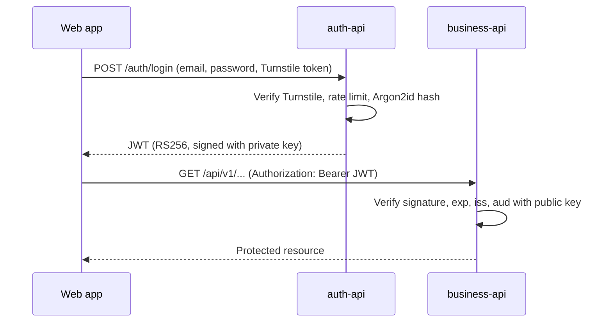

# Security

## Authentication flow

## JWT with RS256

- `auth-api` signs tokens with an **RSA private key**. It is the only component that can issue tokens.
- `business-api` holds only the **public key**. It can verify tokens but never create them, so the authentication responsibility is not duplicated.
- No user credentials are shared between services.

Claims included in every token:

| Claim | Purpose |
| --- | --- |
| `sub` | User identifier |
| `role` | Authorization role (`root`, `admin` or `user`) |
| `iss` | Issuer, must match the value expected by `business-api` |
| `aud` | Audience, must match the value expected by `business-api` |
| `iat` / `exp` | Issue and expiration time |

`business-api` rejects a token when the signature is invalid, the token is expired, or `iss`/`aud` do not match. Decoding the payload alone is never enough.

## Key management per environment

| Environment | How keys are provided |
| --- | --- |
| Local | Generated with `infrastructure/scripts/generate-jwt-keys.sh` into `secrets/jwt/` (ignored by Git) and mounted read-only into the containers |
| CI | A fresh key pair is generated on every run; no secret is stored |
| Staging / production | Private key stored as a GitHub Actions secret and written to the server with `600` permissions; only `auth-api` receives it |

Rotation: generate a new pair, deploy the public key to `business-api`, then the private key to `auth-api`. Tokens signed with the old key expire on their own.

## Roles

Roles follow a strict hierarchy: `root` > `admin` > `user`. A user can only manage accounts with a lower role than their own.

| Action | root | admin | user |
| --- | --- | --- | --- |
| Use the business API | Yes | Yes | Yes |
| Create, update and deactivate `user` accounts | Yes | Yes | No |
| Create, update and deactivate `admin` accounts | Yes | No | No |
| Modify or deactivate the `root` account | No | No | No |

- With only two roles, an admin could deactivate another admin and the platform could end up without any administrator. A single `root` above them removes that state without extra rules.
- There is exactly one `root`. Its credentials are defined in the `auth-api` environment and seeded on startup: the password is hashed with Argon2id before it is stored, and the account cannot be created, changed or deactivated through the API.

## Permissions

A role only gates how far an account can go in managing other accounts (`4.1.6`); it says nothing about which business operations that account can perform. Without a separate permission layer every role would call the same `business-api` endpoints with the same rights, which defeats the point of having more than one role. Permissions close that gap: a fixed catalog of operations, granted to a role by default and adjustable per role by whoever is allowed to.

**Catalog** (`resource:action`):

| Permission | Default: `root` | Default: `admin` | Default: `user` |
| --- | --- | --- | --- |
| `clients:read` | Yes | Yes | Yes |
| `clients:write` | Yes | Yes | Yes |
| `engines:read` | Yes | Yes | Yes |
| `engines:write` | Yes | Yes | Yes |
| `repair_orders:read` | Yes | Yes | Yes |
| `repair_orders:write` | Yes | Yes | Yes |
| `users:manage` | Yes | Yes | No |
| `permissions:manage` | Yes | Yes | No |

`write` covers create, update and deactivate for that resource; `root` always has every permission.

**Grant and revoke.** Permissions are assigned to a role, not to an individual account, and stored in `role_permissions` (`auth_db`). Whoever holds `permissions:manage` may only change the permissions of a role strictly below their own:

- `root` can change the permissions of `admin` and `user`.
- `admin` can change the permissions of `user` only.
- Nobody can change the permissions of their own role or a role above it: an `admin` cannot change another `admin`'s permissions (there is no per-account distinction, only per role), and `user` cannot change anyone's.
- `root`'s permissions are hardcoded to "every permission" and are never read from `role_permissions`; the API refuses any attempt to change them.

**How it reaches `business-api`.** At login, `auth-api` resolves the caller's current permissions (role defaults overridden by `role_permissions`) and embeds them as a `permissions` claim in the JWT. `business-api` keeps verifying signature, `exp`, `iss` and `aud` as always, and additionally checks that the claim contains the permission a given endpoint requires. Because the list travels inside the token, a revoked permission only takes effect the next time the account logs in, the same trade-off already accepted for the `role` claim; this keeps `business-api` from ever calling back into `auth-api` to resolve authorization.

**Status.** Not implemented yet. Today every endpoint of `clients` and `engines` only requires a valid token, regardless of role. The `role_permissions` table, the grant/revoke endpoints and their hierarchy check, the `permissions` claim, and the `require_permission` dependency in `business-api` are built together in the `auth-api` branches, since the permission data is administered there.

## Passwords

Passwords are hashed with **Argon2id** in `auth-api`. Plain passwords are never stored or logged. `business-api` stores no passwords.

## Hardening

- Cloudflare Turnstile on login to block automated attempts.
- Rate limiting on both APIs, stricter on authentication endpoints.
- Security headers and restricted CORS origins.
- Input validation on every endpoint (Pydantic and zod).
- Every setting comes from environment variables; `.env` files are never committed, only `.env.example` with non-sensitive values.

## Database isolation

Each service connects with its own PostgreSQL role, which owns only its database. `CONNECT` is revoked from `PUBLIC`, so the role of one service cannot open the database of the other.
