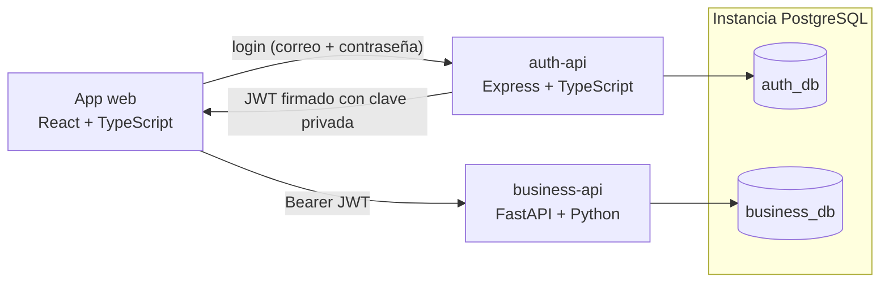

# Arquitectura

## Componentes

| Componente | Responsabilidad | Posee |
| --- | --- | --- |
| App web | Login, dashboard, vistas de clientes, motores y órdenes | Ningún dato |
| auth-api | Registro y gestión de usuarios, roles, login, emisión de JWT | `auth_db`, clave privada RSA |
| business-api | Clientes, motores, órdenes de reparación e historial de estados | `business_db`, clave pública RSA |

## Comunicación

- La app web se autentica **solo** contra `auth-api` y recibe un JWT.
- La app web envía ese JWT como token `Bearer` a `business-api`.
- `business-api` verifica el token localmente con la clave pública. Nunca llama a `auth-api` para validar una petición, así ambos servicios funcionan y escalan de forma independiente.
- Dentro de un mismo host, los servicios se comunican por la red privada de Docker (HTTP). Entre hosts, el tráfico pasa por Nginx con TLS (HTTPS).

## Diseño por capas

Ambas API siguen la misma estructura orientada a objetos por capas:

| Capa | business-api (FastAPI) | auth-api (Express) |
| --- | --- | --- |
| Transporte | Routers + esquemas Pydantic | Rutas + controladores + esquemas zod |
| Reglas de negocio | Servicios | Servicios |
| Acceso a datos | Repositorios (SQLAlchemy) | Repositorios (Prisma) |
| Persistencia | Migraciones Alembic | Migraciones Prisma |

Los routers nunca acceden directamente a la base de datos. Los servicios dependen de repositorios, lo que mantiene las reglas de negocio testeables y el almacenamiento reemplazable.

## Decisiones de escalabilidad

- **Listados paginados**: todo endpoint de listado está paginado con un tamaño de página máximo, así ninguna petición carga la tabla completa.
- **Paginación por cursor en órdenes**: el listado de órdenes usa un cursor sobre `(created_at, id)`, que mantiene constante el costo de cada página incluso con millones de filas, a diferencia de un `OFFSET` profundo.
- **Sin consultas N+1**: los datos relacionados (motor, cliente) se cargan con eager loading en la misma ida a la base de datos en lugar de una consulta por fila. Un test cuenta las sentencias SQL del listado de órdenes y comprueba que una página más grande nunca añade consultas.
- **Resumen del tablero en una consulta**: `GET /api/v1/repair-orders/summary` cuenta las órdenes de cada estado con un único `GROUP BY`, en lugar de que la app web recorra todas las órdenes para contarlas.
- **Búsqueda sin idas extra a la base**: la búsqueda de órdenes compara directamente el número de orden y el problema reportado, y el número de serie del motor y el nombre del cliente mediante subconsultas `EXISTS` correlacionadas, así sigue siendo una sola sentencia. Usa `ILIKE '%texto%'`, que un índice B-tree no puede resolver; si la tabla crece mucho, un índice GIN con `pg_trgm` sobre esas columnas la volvería indexada.
- **Índices** en cada columna usada para filtrar u ordenar (estado, cliente, motor, fecha de creación).
- **Base de datos por servicio** en una sola instancia de PostgreSQL: simple de operar hoy y lista para mover cada base a su propio servidor.

## Logging

Cada servicio escribe logs de consola con colores y guarda una copia sin colores en `logs/<servicio>/<YYYY-MM>/<YYYY-MM-DD>.log`. Los niveles de log admiten una verbosidad numérica y se pueden suprimir niveles concretos mediante variables de entorno para reducir el ruido.
