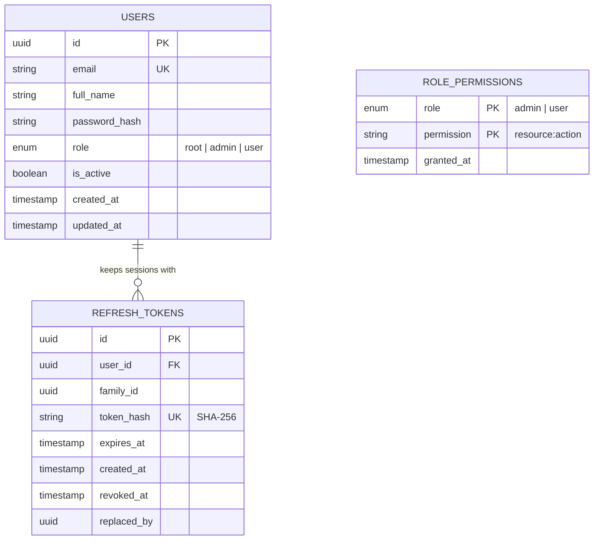
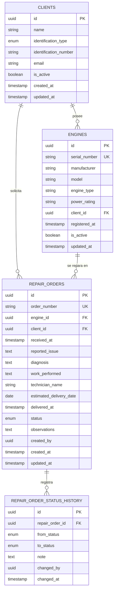

# Modelo de datos

Cada servicio posee su propia base de datos dentro de la misma instancia de PostgreSQL. No hay claves foráneas entre bases: `business-api` guarda el identificador del usuario del JWT (`sub`) como un UUID simple.

## auth_db (auth-api)

- `users` y `role_permissions` comparten el enum `role` pero no tienen clave foránea: los permisos pertenecen a un rol, no a una cuenta.
- Un índice único parcial sobre `users(role) WHERE role = 'root'` garantiza un único `root`.
- `role_permissions` nunca guarda filas de `root` (restricción check), cuyos permisos son el catálogo completo, y solo acepta permisos del catálogo. Sus filas por defecto las inserta la migración inicial.
- `refresh_tokens` pertenece a `users` (`ON DELETE CASCADE`) y solo guarda el hash SHA-256 de cada token. Los tokens de una sesión comparten `family_id`; `replaced_by` enlaza un token rotado con su sucesor, y `revoked_at` marca los que ya no se pueden usar.

## business_db (business-api)

## Restricciones y reglas

- **Clientes**: `(identification_type, identification_number)` único para evitar duplicados.
- **Motores**: `serial_number` único.
- **Órdenes**: `order_number` único. El cliente se guarda en la orden como una foto del propietario al momento de la recepción, y debe coincidir con el propietario del motor al crear la orden.
- **Estados**: `received` (Recibido), `in_diagnosis` (En diagnóstico), `awaiting_approval` (Esperando aprobación), `in_repair` (En reparación), `in_testing` (En pruebas), `finished` (Finalizado), `delivered` (Entregado). Cada cambio crea una fila en `repair_order_status_history`.
- **Técnico**: se guarda como texto de referencia; no requiere cuenta de usuario.
- **Borrado lógico**: clientes y motores se desactivan (`is_active = false`) en lugar de eliminarse, para conservar el historial de órdenes. Una edición con `is_active: true` los reactiva; una edición sin `is_active` conserva el estado actual.

## Índices

| Tabla | Índice | Motivo |
| --- | --- | --- |
| `engines` | `client_id` | Motores de un cliente |
| `repair_orders` | `status` | Dashboard y filtro por estado |
| `repair_orders` | `client_id`, `engine_id` | Filtros por cliente y motor |
| `repair_orders` | `(created_at, id)` | Paginación por cursor |
| `repair_order_status_history` | `(repair_order_id, changed_at)` | Línea de tiempo de la orden |

## Inicialización

- El contenedor de PostgreSQL ejecuta `infrastructure/scripts/postgres/01-create-databases.sh` en el primer arranque para crear ambas bases y sus roles.
- Cada servicio aplica su propio esquema con su herramienta de migraciones (Alembic en `business-api`, Prisma en `auth-api`).
