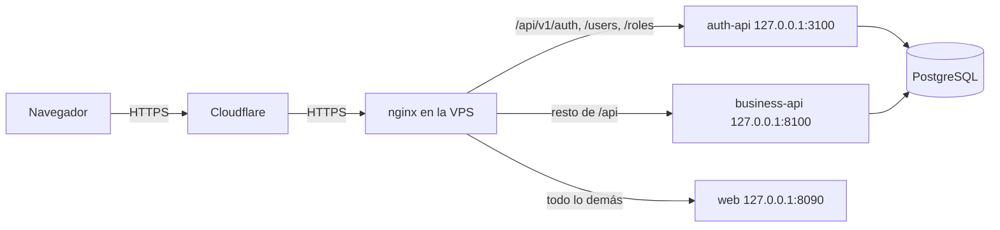

# Despliegue

Cada merge a `main` despliega Motorix en una sola VPS con Ubuntu. GitHub Actions construye una imagen por componente, las publica en el GitHub Container Registry y le indica al servidor que las descargue y reinicie el stack. Cada API aplica sus propias migraciones al arrancar su contenedor, antes de atender peticiones.

## Topología

- La web y las dos API comparten un mismo origen, `https://motorix.zerikapi.site`, así que el navegador no necesita CORS y la cookie de refresh conserva su `Path=/api/v1/auth`.
- Los contenedores solo publican puertos en `127.0.0.1`; PostgreSQL no publica ninguno. Los servicios se comunican entre sí y con la base por la red de Docker.
- nginx toma la dirección del cliente de `CF-Connecting-IP` solo cuando la petición llega desde un rango de Cloudflare, y la reenvía como único valor de `X-Forwarded-For`, así que los rate limits cuentan clientes reales.

## Archivos

| Archivo | Función |
| --- | --- |
| `services/*/Dockerfile`, `apps/web/Dockerfile` | Imágenes. Las API corren sus migraciones (`prisma migrate deploy`, `alembic upgrade head`) y luego arrancan; la imagen de la web sirve el build estático con nginx. Cada imagen tiene health check. |
| `compose.yaml` | El stack completo, que se puede construir en local con `docker compose up -d --build`. |
| `compose.prod.yaml` | Override de producción: imágenes del registry etiquetadas con el commit, configuración de producción y puertos en `127.0.0.1`. |
| `infrastructure/nginx/motorix.zerikapi.site.conf` | Sitio del nginx del servidor: TLS, cabeceras de seguridad y enrutamiento. |
| `infrastructure/nginx/cloudflare-real-ip.conf` | Rangos de Cloudflare en los que se confía para la dirección del cliente. |
| `infrastructure/scripts/bootstrap-server.sh` | Preparación única: escribe los `.env` de producción con contraseñas aleatorias y genera el par de claves RS256. Nunca sobrescribe un archivo existente. |
| `infrastructure/scripts/deploy.sh` | Descarga las imágenes de un commit, levanta el stack, espera a que pasen todos los health checks y borra las imágenes anteriores de Motorix. |
| `.github/workflows/deploy.yml` | Corre en cada push a `main`, o a mano. |

## Configuración de GitHub

Crea el environment `production` en **Settings → Environments** y añade:

| Tipo | Nombre | Valor |
| --- | --- | --- |
| Secret | `VPS_HOST` | Dirección del servidor. |
| Secret | `VPS_USER` | Usuario que hace el despliegue; debe pertenecer al grupo `docker`. |
| Secret | `VPS_SSH_KEY` | Clave privada de un par usado solo para desplegar. |
| Secret | `VPS_KNOWN_HOSTS` | Salida de `ssh-keyscan -t ed25519 <host>`, para que el runner verifique el servidor. |
| Variable | `PUBLIC_URL` | `https://motorix.zerikapi.site` |
| Variable | `TURNSTILE_SITE_KEY` | Clave pública del sitio de Turnstile para el dominio. |

El despliegue inicia sesión del servidor en el registry con el token temporal de la ejecución y la cierra al terminar, así que en el servidor no queda ninguna credencial del registry.

## Preparación del servidor

Se hace una sola vez, con el usuario de despliegue:

1. Clona el repositorio en `~/motorix` y ejecuta `sh infrastructure/scripts/bootstrap-server.sh https://motorix.zerikapi.site <correo de root>`.
2. Pon `TURNSTILE_SECRET_KEY` en `services/auth-api/.env`; `auth-api` se niega a arrancar en producción sin ella.
3. Lee la primera contraseña de `root` en `services/auth-api/.env`, inicia sesión, cámbiala desde la app y quita `ROOT_PASSWORD` del archivo.
4. Con `sudo`: copia `cloudflare-real-ip.conf` a `/etc/nginx/snippets/`, saca el certificado con `certbot certonly --nginx -d motorix.zerikapi.site`, copia el sitio a `/etc/nginx/sites-available/`, actívalo y ejecuta `nginx -t && systemctl reload nginx`.

## Cloudflare

| Ajuste | Valor |
| --- | --- |
| Registro DNS | `A`, nombre `motorix`, contenido la dirección del servidor, TTL automático |
| Estado del proxy | Solo DNS mientras certbot emite el primer certificado, después con proxy |
| Modo SSL/TLS | Completo (estricto) |
| Widget de Turnstile | Hostname `motorix.zerikapi.site` |
