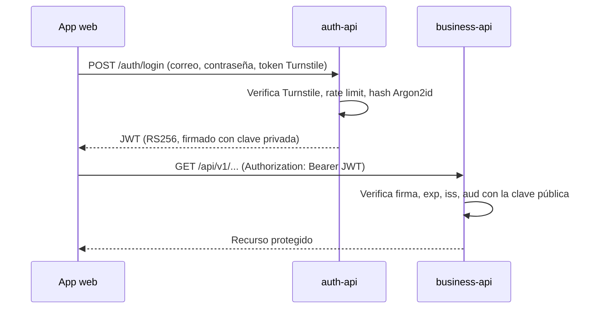

# Seguridad

## Flujo de autenticación

## JWT con RS256

- `auth-api` firma los tokens con una **clave privada RSA**. Es el único componente que puede emitir tokens.
- `business-api` solo tiene la **clave pública**. Puede verificar tokens pero nunca crearlos, por lo que la responsabilidad de autenticación no se duplica.
- No se comparten credenciales de usuarios entre servicios.

Claims incluidos en cada token:

| Claim | Propósito |
| --- | --- |
| `sub` | Identificador del usuario |
| `role` | Rol de autorización (`root`, `admin` o `user`) |
| `iss` | Emisor, debe coincidir con el esperado por `business-api` |
| `aud` | Audiencia, debe coincidir con la esperada por `business-api` |
| `iat` / `exp` | Fecha de emisión y expiración |

`business-api` rechaza un token si la firma es inválida, si expiró o si `iss`/`aud` no coinciden. Decodificar el contenido nunca es suficiente.

## Gestión de claves por entorno

| Entorno | Cómo se proveen las claves |
| --- | --- |
| Local | Se generan con `infrastructure/scripts/generate-jwt-keys.sh` en `secrets/jwt/` (ignorado por Git) y se montan en solo lectura en los contenedores |
| CI | Se genera un par nuevo en cada ejecución; no se almacena ningún secreto |
| Staging / producción | La clave privada se guarda como secreto de GitHub Actions y se escribe en el servidor con permisos `600`; solo `auth-api` la recibe |

Rotación: se genera un par nuevo, se despliega la clave pública en `business-api` y luego la privada en `auth-api`. Los tokens firmados con la clave anterior expiran por sí solos.

## Roles

Los roles siguen una jerarquía estricta: `root` > `admin` > `user`. Un usuario solo puede gestionar cuentas con un rol inferior al suyo.

| Acción | root | admin | user |
| --- | --- | --- | --- |
| Usar la API de negocio | Sí | Sí | Sí |
| Crear, actualizar y desactivar cuentas `user` | Sí | Sí | No |
| Crear, actualizar y desactivar cuentas `admin` | Sí | No | No |
| Modificar o desactivar la cuenta `root` | No | No | No |

- Con solo dos roles, un admin podría desactivar a otro admin y la plataforma podría quedarse sin ningún administrador. Un único `root` por encima de ellos elimina ese estado sin reglas adicionales.
- Existe exactamente un `root`. Sus credenciales se definen en el entorno de `auth-api` y se siembran al arrancar: la contraseña se cifra con Argon2id antes de guardarse, y la cuenta no se puede crear, modificar ni desactivar a través de la API.

## Contraseñas

Las contraseñas se cifran con **Argon2id** en `auth-api`. Nunca se almacenan ni se registran en logs en texto plano. `business-api` no almacena contraseñas.

## Endurecimiento

- Cloudflare Turnstile en el login para bloquear intentos automatizados.
- Rate limiting en ambas API, más estricto en los endpoints de autenticación.
- Cabeceras de seguridad y orígenes CORS restringidos.
- Validación de entradas en cada endpoint (Pydantic y zod).
- Toda la configuración viene de variables de entorno; los `.env` nunca se suben, solo `.env.example` con valores no sensibles.

## Aislamiento de bases de datos

Cada servicio se conecta con su propio rol de PostgreSQL, dueño únicamente de su base de datos. Se revoca `CONNECT` a `PUBLIC`, por lo que el rol de un servicio no puede abrir la base del otro.
