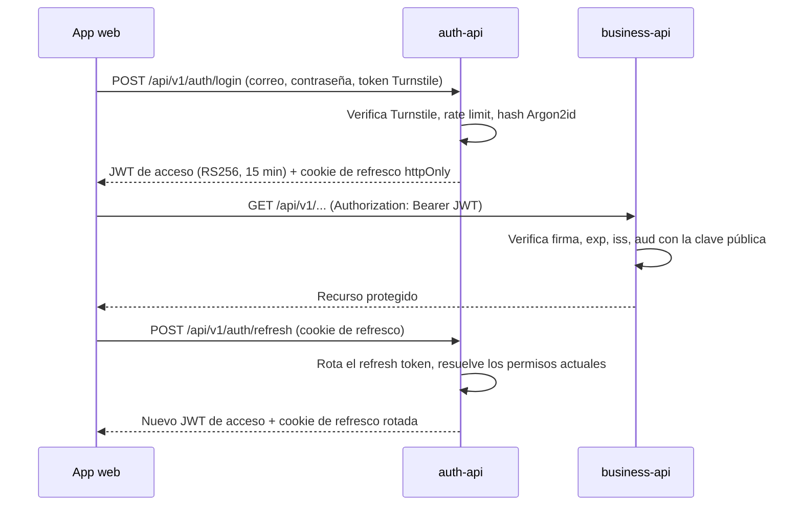

# Seguridad

## Flujo de autenticación

## JWT con RS256

- `auth-api` firma los tokens con una **clave privada RSA**. Es el único componente que puede emitir tokens.
- `business-api` solo tiene la **clave pública**. Puede verificar tokens pero nunca crearlos, por lo que la responsabilidad de autenticación no se duplica.
- No se comparten credenciales de usuarios entre servicios.

Claims incluidos en cada token:

| Claim | Propósito |
| --- | --- |
| `sub` | Identificador del usuario |
| `role` | Rol de autorización (`root`, `admin` o `user`) |
| `permissions` | Permisos que tenía el rol al iniciar sesión (ver [Permisos](#permisos)) |
| `iss` | Emisor, debe coincidir con el esperado por `business-api` |
| `aud` | Audiencia, debe coincidir con la esperada por `business-api` |
| `iat` / `exp` | Fecha de emisión y expiración |

`business-api` rechaza un token si la firma es inválida, si expiró o si `iss`/`aud` no coinciden. Decodificar el contenido nunca es suficiente.

## Gestión de claves por entorno

| Entorno | Cómo se proveen las claves |
| --- | --- |
| Local | Se generan con `infrastructure/scripts/generate-jwt-keys.sh` en `secrets/jwt/` (ignorado por Git) y se montan en solo lectura en los contenedores |
| CI | Se genera un par nuevo en cada ejecución; no se almacena ningún secreto |
| Staging / producción | La clave privada se guarda como secreto de GitHub Actions y se escribe en el servidor con permisos `600`; solo `auth-api` la recibe |

Rotación: se genera un par nuevo, se despliega la clave pública en `business-api` y luego la privada en `auth-api`. Los tokens firmados con la clave anterior expiran por sí solos.

## Sesiones

El token de acceso dura poco (`JWT_EXPIRES_IN_SECONDS`, 15 minutos por defecto) y la app web lo guarda **solo en memoria**, nunca en `localStorage` ni `sessionStorage`, así un script inyectado en la página no encuentra ningún token guardado que robar. Viaja como `Authorization: Bearer`, que es lo que verifica `business-api`.

La sesión se mantiene con un **refresh token**:

- Un valor aleatorio de 256 bits que solo viaja como la cookie `motorix_refresh`: `HttpOnly` (los scripts no pueden leerla), `Secure`, `SameSite=Strict` (otros sitios no pueden hacer que el navegador la envíe) y `Path=/api/v1/auth` (nunca llega a `business-api` ni a otra ruta).
- Solo se guarda su hash SHA-256, en `refresh_tokens`. Un hash rápido basta porque el valor es aleatorio y largo; no es una contraseña.
- `POST /api/v1/auth/refresh` lo cambia por un token de acceso nuevo, con los permisos que tiene el rol en ese momento, y lo **rota**: el token usado se revoca y uno nuevo ocupa su lugar. Al recargar la página, la app web lo llama para recuperar la sesión sin pedir la contraseña.
- **Detección de reutilización**: los tokens de una sesión forman una familia. Presentar un token que ya fue rotado significa que alguien lo copió, así que se revoca toda la familia y tanto el atacante como el dueño deben iniciar sesión de nuevo. La revocación es un update condicional, así dos peticiones que compiten con el mismo token no pueden tener éxito las dos.
- **Vida absoluta**: una sesión termina `REFRESH_TOKEN_TTL_SECONDS` después del login (12 horas por defecto, un turno de trabajo); la rotación nunca la alarga.
- **Revocación**: `POST /api/v1/auth/logout` termina la sesión; desactivar una cuenta, restablecer su contraseña o cambiar la propia termina todas las sesiones de esa cuenta.

## Roles

Los roles siguen una jerarquía estricta: `root` > `admin` > `user`. Un usuario solo puede gestionar cuentas con un rol inferior al suyo.

| Acción | root | admin | user |
| --- | --- | --- | --- |
| Usar la API de negocio | Sí | Sí | Sí |
| Crear, actualizar y desactivar cuentas `user` | Sí | Sí | No |
| Crear, actualizar y desactivar cuentas `admin` | Sí | No | No |
| Modificar o desactivar la cuenta `root` | No | No | No |

- Con solo dos roles, un admin podría desactivar a otro admin y la plataforma podría quedarse sin ningún administrador. Un único `root` por encima de ellos elimina ese estado sin reglas adicionales.
- Existe exactamente un `root`. Sus credenciales se definen en el entorno de `auth-api` y se siembran al arrancar: la contraseña se cifra con Argon2id antes de guardarse, y la cuenta no se puede crear, modificar ni desactivar a través de la API.
- Cambiar un rol exige estar por encima tanto del rol actual como del nuevo, así que un `admin` no puede ascender a un `user` a `admin` ni editar a otro `admin`. Las cuentas desactivadas se conservan, nunca se borran.
- `auth-api` lee la cuenta del llamante y los permisos de su rol desde la base en cada request, así que una desactivación o un cambio de permisos se aplica ahí de inmediato. `business-api` solo ve el token, así que ahí se aplica cuando el token de acceso expira, como mucho 15 minutos después por defecto: una cuenta desactivada no puede renovarlo, porque sus sesiones quedan revocadas, y tras un cambio de permisos el token renovado trae la lista nueva.

## Permisos

Un rol solo limita hasta dónde puede llegar una cuenta administrando otras cuentas (`4.1.6`); no dice nada sobre qué operaciones de negocio puede hacer esa cuenta. Sin una capa de permisos separada, todos los roles llamarían a los mismos endpoints de `business-api` con los mismos derechos, lo cual anula el sentido de tener más de un rol. Los permisos cierran esa brecha: un catálogo fijo de operaciones, otorgadas a un rol por defecto y ajustables por rol por quien tenga autorización para hacerlo.

**Catálogo** (`recurso:acción`):

| Permiso | Por defecto: `root` | Por defecto: `admin` | Por defecto: `user` |
| --- | --- | --- | --- |
| `clients:read` | Sí | Sí | Sí |
| `clients:write` | Sí | Sí | No |
| `engines:read` | Sí | Sí | Sí |
| `engines:write` | Sí | Sí | No |
| `repair_orders:read` | Sí | Sí | Sí |
| `repair_orders:write` | Sí | Sí | Sí |
| `users:manage` | Sí | Sí | No |
| `permissions:manage` | Sí | Sí | No |

`write` cubre crear, actualizar y desactivar ese recurso (en órdenes de reparación, crear y cambiar el estado); `root` siempre tiene todos los permisos. El rol `user` es el operativo: consulta todo y gestiona las órdenes de reparación, mientras que registrar y editar clientes y motores queda para `admin`. Los valores por defecto los inserta la migración inicial de `auth-api`, así que los cambios hechos después por la API nunca se sobrescriben al reiniciar.

**Otorgar y revocar.** Los permisos se asignan a un rol, no a una cuenta individual, y se guardan en `role_permissions` (`auth_db`). Quien tenga `permissions:manage` solo puede cambiar los permisos de un rol estrictamente inferior al suyo:

- `root` puede cambiar los permisos de `admin` y de `user`.
- `admin` solo puede cambiar los permisos de `user`.
- Nadie puede cambiar los permisos de su propio rol ni de uno superior: un `admin` no puede cambiar los permisos de otro `admin` (no hay distinción por cuenta, solo por rol), y `user` no puede cambiar los de nadie.
- Nadie puede otorgar ni revocar un permiso que no tiene. Si no fuera así, cuando `root` le quitara `clients:write` a `admin`, un `admin` todavía podría dárselo a `user`.
- Los permisos de `root` están fijos en el código como "todos los permisos" y nunca se leen de `role_permissions`; la base de datos rechaza filas para `root` y la API rechaza cualquier intento de modificarlos.

**Cómo llega a `business-api`.** Al iniciar sesión, `auth-api` resuelve los permisos actuales de la cuenta (leídos de `role_permissions`, o el catálogo completo para `root`) y los incluye como claim `permissions` en el JWT. `business-api` sigue verificando firma, `exp`, `iss` y `aud` como siempre, y además comprueba que ese claim contenga el permiso que exige cada endpoint. Como la lista viaja dentro del token, revocar un permiso solo tiene efecto en `business-api` cuando la app web renueva su token de acceso, como mucho 15 minutos después con el `JWT_EXPIRES_IN_SECONDS` por defecto, la misma concesión que se acepta para el claim `role`; así `business-api` nunca necesita llamar de vuelta a `auth-api` para resolver autorización.

**Endpoints.** Todos exigen `permissions:manage`:

| Endpoint | Propósito |
| --- | --- |
| `GET /api/v1/roles` | El catálogo y cada rol con sus permisos actuales, indicando cuáles puede cambiar quien llama (`editable`) |
| `PUT /api/v1/roles/{role}/permissions/{permission}` | Otorgar; otorgar un permiso que el rol ya tiene no cambia nada |
| `DELETE /api/v1/roles/{role}/permissions/{permission}` | Revocar; revocar un permiso que el rol no tiene no cambia nada |

Revocarle un permiso a `admin` no se lo quita a `user`: cada rol conserva su propia lista, y `root` puede revocárselo a `user` directamente. Cada otorgamiento y revocación queda en el log con la cuenta que lo hizo.

**Aplicación en `business-api`.** Cada endpoint de negocio exige su permiso mediante la dependencia `require_permission`: `*:read` para listar y consultar, `*:write` para crear, actualizar, desactivar o cambiar el estado de una orden de reparación. Un token sin él recibe `403` con el permiso faltante en `details`. El claim `permissions` es obligatorio, los permisos que este servicio todavía no conoce se ignoran, y `root` pasa sin importar su claim. `GET /api/v1/me` devuelve los permisos que trae el token.

## Contraseñas

Las contraseñas se cifran con **Argon2id** en `auth-api`. Nunca se almacenan ni se registran en logs en texto plano. `business-api` no almacena contraseñas.

## Endurecimiento

- **Cloudflare Turnstile en el login.** La app web envía el token del widget como `turnstile_token`, y `auth-api` lo valida con Cloudflare del lado del servidor antes incluso de mirar la contraseña, así un bot nunca llega a gastar un hash Argon2id. Un token ausente o rechazado responde `400 captcha_failed`; si Cloudflare no responde, `503`. Sin `TURNSTILE_SECRET_KEY` la verificación se omite con una advertencia al arrancar, lo que solo se permite fuera de `production`. En local, las [claves de prueba](https://developers.cloudflare.com/turnstile/troubleshooting/testing/) de Cloudflare fuerzan un acierto o un fallo.
- **Rate limiting en ambas API**, por dirección del cliente y respondido con `429` y `Retry-After`:
    - Todas las rutas de `/api` de cada servicio: `RATE_LIMIT_MAX` peticiones por `RATE_LIMIT_WINDOW_SECONDS` (300 cada 15 minutos por defecto). `/health` y la referencia de la API nunca se limitan.
    - Login, en `auth-api`: `LOGIN_RATE_LIMIT_MAX` intentos fallidos por `LOGIN_RATE_LIMIT_WINDOW_SECONDS` (10 cada 15 minutos por defecto). Los logins exitosos no cuentan, así quien se equivoca una vez no queda bloqueado, mientras que un ataque de fuerza bruta se detiene a los pocos intentos.
    - La dirección del cliente se toma de `X-Forwarded-For` solo desde proxies de confianza, así la cabecera no se puede falsificar para esquivar el límite: en `auth-api`, `TRUST_PROXY` indica cuántos proxies hay delante (por defecto `0`, la cabecera se ignora); en `business-api`, uvicorn solo la lee desde las direcciones de `FORWARDED_ALLOW_IPS` (por defecto `127.0.0.1`).
    - Los contadores viven en la memoria de cada proceso, suficiente para una sola instancia; varias instancias necesitarían un almacén compartido como Redis.
- Cabeceras de seguridad y orígenes CORS restringidos.
- Validación de entradas en cada endpoint (Pydantic y zod).
- Toda la configuración viene de variables de entorno; los `.env` nunca se suben, solo `.env.example` con valores no sensibles.

## Aislamiento de bases de datos

Cada servicio se conecta con su propio rol de PostgreSQL, dueño únicamente de su base de datos. Se revoca `CONNECT` a `PUBLIC`, por lo que el rol de un servicio no puede abrir la base del otro.
